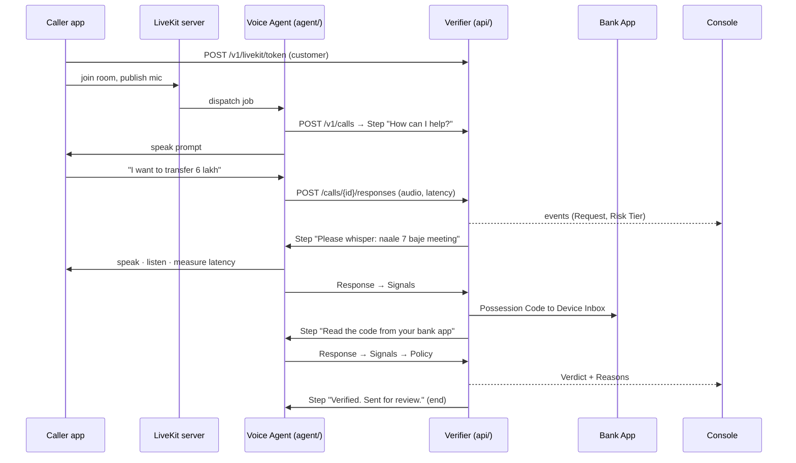
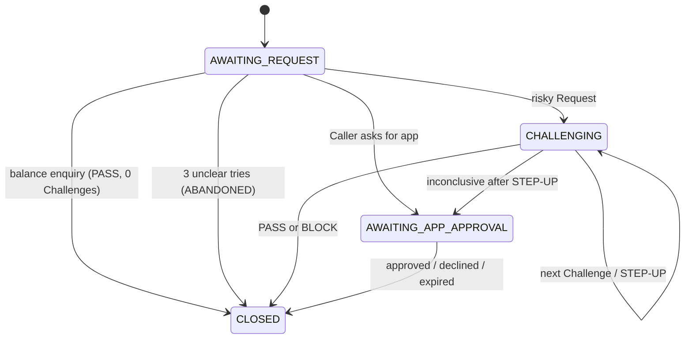

# Pratyaksh: Product Requirements

**Team Omnitrons** · FET Aavishkar 2026 · Cybersecurity · Problem statement **#F1BBBA03, "Voice-clone consent verification protocol"**
Finale: 24-hour build, Oct 31 – Nov 1, 2026. Pre-built code is allowed.

Terms in *italics-free capitals* such as Caller, Challenge, Signal and Verdict are defined in [`CONTEXT.md`](../CONTEXT.md). Architectural decisions are in [`docs/adr/`](adr/).

---

## 1. Problem

A scammer needs about 10 seconds of someone's voice to clone it. They call the bank as that Customer and ask for a SIM swap, a new payee or a large transfer. Voiceprint checks accept the Clone because it sounds like the Customer. The problem statement asks for a challenge-response scheme that tells a bank or call centre the Caller is not an AI Clone, **without static voiceprints**.

## 2. What we build

Pratyaksh is a Voice Agent that sits in front of risky Requests on a bank call. It asks the Caller to complete random live Challenges, measures Signals from each Response, and returns a Verdict (PASS, STEP-UP or BLOCK) with Reasons. It never stores anyone's voice.

**Goals for the finale**
1. A live browser call where a real Customer passes in under 20 seconds of added time.
2. The same call placed with a Clone of that Customer is BLOCKed, live, in front of judges.
3. Every Verdict shows its Reasons on the Console.
4. An Eval Run over our own recordings reports Catch Rate, False Reject Rate and Added Time.

**Non-goals**
- Real phone numbers or SIP (stretch only, see ADR-0005).
- Speaker identification of any kind (ADR-0003).
- Real banking actions. Requests are recorded, not executed.
- User accounts and login. One demo environment.

## 3. People

| Who | What they do | Where |
|---|---|---|
| Caller (real Customer) | Calls the bank, completes Challenges | Caller app |
| Caller (impostor) | Calls as the Customer using a Clone | Caller app on the attacker laptop + `attacker/` tools |
| Customer's Registered Device | Shows Possession Codes and App Approval prompts | Bank App |
| Bank Agent | Watches Calls live, reads Reasons, handles Agent Review | Console |
| Team / judges | Read Eval Run results | Eval page |

## 4. Features

### Must-have (finale demo depends on these)
| # | Feature | Acceptance |
|---|---|---|
| M1 | Browser voice call over self-hosted LiveKit | Caller app joins a room; Voice Agent greets within 2 s |
| M2 | Understand anything | Caller may say a Request, a Question, "repeat", "a person please" or "bye" in English, Hindi, Kannada or a mix. Keyword rules first, LLM for the rest; Questions answered from `knowledge.yaml`; unknown account changes become "account service" and are verified; never a dead end (Hand-over instead of hanging up) |
| M2b | Never fail mid-call | LLM down → keyword rules; speech model error → ask again, then Hand-over; TTS error → fallback tone; agent crash → Call closed cleanly |
| M3 | Risk Tiers from Policy | balance = 0 Challenges · add payee = 2 · other account service = 2 · SIM swap/password reset = 3 · transfer > ₹5 lakh = 3 + Agent Review |
| M4 | Whisper Phrase Challenge | Random code-mixed phrase; Task Match (fuzzy, script-agnostic) + Whisper Score |
| M5 | Possession Code Challenge | 6-digit code to the Bank App; spoken digits parsed in en/hi/kn; Code Match |
| M6 | Reply Latency Signal | Measured from end of prompt playout to start of speech |
| M7 | Spoof Score Signal | wav2vec2 deepfake classifier; `enforce` or `advisory` mode in Policy |
| M8 | Verdict with Reasons | Policy combines Signals into PASS / STEP-UP / BLOCK; STEP-UP adds one Whisper Phrase, then offers App Approval |
| M9 | Console | Live list of Calls, live Signals per Response, Verdict, Reasons, Audit Trail tab |
| M10 | Bank App | Shows the active Possession Code and App Approval prompts, only on a paired device (secret pairing link per Customer) |
| M11 | Insert-only Audit Trail | Every event of every Call stored in MySQL; UPDATE/DELETE blocked by triggers |
| M12 | Eval Run | Script replays labelled recordings and stores metrics; Eval page shows them |
| M13 | Red-team tools | IndicF5 live "type-to-speak" Clone + clip player on the attacker laptop |

### Should-have
| # | Feature |
|---|---|
| S1 | App Approval fallback: Caller says they can't do voice tasks, or Verification is inconclusive after STEP-UP; approve on the Registered Device |
| S2 | Agent Review buttons on the Console for high-value transfers, protected by a console key |
| S3 | Pre-generated audio cache for all fixed prompts (fast first response) |
| S4 | Security Alert + Voice Pause: every BLOCK alerts the Registered Device; risky Requests for that Customer are refused on voice until the Customer dismisses the alert (or `protection.pause_minutes`) |
| S5 | Hash-chained Audit Trail: an edited or deleted event is detected even if the triggers are dropped (`GET /v1/calls/{id}/audit`, badge on the Console) |
| S6 | Verification Receipt: Ed25519-signed JWS of a closed Call's result, with `executable` and the Audit Trail head, that core banking checks before acting |
| S7 | Hardening: agent-only endpoints need `AGENT_KEY`; long digit runs never match a Possession Code; 1,344 equally likely Whisper Phrases; LLM replies that claim an outcome or ask for secrets are dropped |
| S8 | Questions answered in the Caller's language (English, Hindi, Kannada) and to fit the moment (before a Request, during a Whisper Phrase, during a Possession Code) |
| S9 | Readiness: `GET /v1/status` (what to fix before the demo) and `GET /v1/stats` (live numbers) on the Console |

### Stretch
- SIP phone line into LiveKit (judges dial in).
- More languages (Tamil, Telugu, Marathi) in the phrase bank.
- Fine-tune the spoof model on our own Indian-language Clone recordings.

## 5. End-to-end flow



### Call states



## 6. Policy (default `policy.yaml`)

Per Response, each Signal becomes a 0–1 component; the Liveness Score is their weighted mean.

| Signal | Component | Default |
|---|---|---|
| Task Match | fuzzy ratio of romanised transcript vs phrase | must be ≥ 0.70 |
| Whisper Score | share of speech frames without voicing | ≥ 0.60 counts as whispered |
| Reply Latency | 1.0 at ≤ 1200 ms, falling to 0 at ≥ 3000 ms | |
| Spoof Score | 1 − P(synthetic) | `enforce`: P ≥ 0.85 is a hard fail |
| Code Match | spoken digits equal the issued code | mismatch is a hard fail |

Decision after the planned Challenges, in order:
1. Any hard fail (wrong code, no reply, synthetic voice in `enforce` mode) → **BLOCK**.
2. Mean Liveness ≤ 0.45 → **BLOCK**.
3. A Whisper Phrase not completed (wrong words, missing digit, or not whispered) → **STEP-UP** with one more Whisper Phrase; a second miss → **BLOCK**.
4. Mean Liveness ≥ 0.75 → **PASS**.
5. Otherwise **STEP-UP** (one extra Whisper Phrase); still inconclusive → hand over to App Approval.

Other rules: a misread Possession Code gets one retry (the code stays valid); a Caller who asks for App Approval after evidence already says BLOCK is blocked, not handed over. Weights and thresholds get tuned from Eval Runs, not guessed.

## 7. Architecture

Five deployables, one Python package. The vocabulary below (module, interface, seam, adapter) follows the codebase-design guide.

```
web/ (Vite+React+TS)  ──HTTP/WS──▶  api/ Verifier (FastAPI, GPU models, MySQL)
        │                                   ▲
        └──WebRTC──▶ LiveKit server ◀──▶ agent/ Voice Agent (LiveKit Agents) ──HTTP──┘
attacker/ (IndicF5, separate laptop) ──audio──▶ Caller app mic
eval/ ──imports──▶ pratyaksh package (Signals + Policy)
```

### Deep modules

| Module | Interface (all a caller needs) | Hides | Seam / adapters | Tested through |
|---|---|---|---|---|
| `Verifier` | `start_call`, `respond`, `current_step`, `app_approval`, `review`, `hang_up`, plus reads | Call state machine, Request classification, Challenge planning, phrase generation, Possession Codes, Device Inbox, Policy calls, Audit Trail, events | DB is local-substitutable (MySQL in prod, SQLite in tests, same models). Speech models and LLM injected | `tests/test_verifier.py`: full Calls with fake speech models |
| `SignalExtractor` | `transcribe(audio)`, `extract(challenge, response)` | Romanisation of Kannada/Devanagari, digit words in 3 languages, fuzzy matching, whisper DSP, STT + spoof inference | `SpeechModels` port: `LocalSpeechModels` (faster-whisper + transformers) and `ScriptedSpeechModels` (tests) | `tests/test_signals.py` with synthetic voiced/whispered audio |
| `Policy` | `plan(request)`, `decide(evidence, step_ups_used)` | Signal → component mapping, weights, hard fails, STEP-UP and App Approval rules, Reasons text | none (pure, in-process) | `tests/test_policy.py` |
| `PromptVoice` | `render(text) → wav` | Parler-TTS loading, speaker description, disk cache | `ParlerVoice` and `ToneVoice` (no-GPU dev) | via API test |
| Call loop (`agent/call_loop.py`) | `run_call(audio, verifier, customer_id, room)` | Turn-taking, playout waits, listen timeouts, App Approval polling, hang-up | `CallAudio` port: LiveKit adapter + scripted fake; `VerifierPort`: HTTP adapter + in-process adapter | `tests/test_call_loop.py`: real Verifier + fake audio |

Rule we followed: a seam only exists where two adapters exist today (production + test/dev). Everything else is plain code inside a module.

## 8. Tech stack

| Layer | Choice | Why |
|---|---|---|
| Voice transport | LiveKit server (self-hosted, Docker) + LiveKit Agents 1.8 (Python) | Open source, WebRTC now and SIP later (ADR-0005) |
| Backend | Python 3.11, FastAPI, SQLAlchemy 2, PyMySQL | All speech libraries are Python |
| Database | MySQL 8 (JSON columns, insert-only Audit Trail triggers) | ADR-0004 |
| Speech-to-text | faster-whisper `large-v3-turbo`, int8_float16 on GPU | Multilingual, fast |
| Voice activity | Silero VAD (via LiveKit plugin) | Reply Latency and end-of-speech |
| Anti-spoof | `MelodyMachine/Deepfake-audio-detection-V2` (wav2vec2, Apache-2.0), configurable | Standard transformers pipeline, swappable |
| Agent voice | AI4Bharat Indic Parler-TTS (Apache-2.0), cached | Free, offline, Kannada/Hindi/English |
| LLM (classification fallback only) | Ollama Cloud API (local Ollama as offline fallback) | ADR-0002 |
| Matching | rapidfuzz, indic-transliteration | Script-agnostic phrase match |
| Frontend | Vite, React 19, TypeScript, Tailwind 4, `livekit-client` | Simple SPA |
| Clone (red team only) | AI4Bharat IndicF5 on the attacker laptop | Indian-language Clones |
| Packaging | Docker Compose (MySQL + LiveKit), `uv`/pip venv, npm | |

GPU budget on a 6–8 GB laptop: Whisper turbo ≈ 1.6 GB, Parler-TTS ≈ 2 GB (fp16), spoof model ≈ 0.4 GB. IndicF5 runs on a different laptop.

## 9. HTTP interface (verifier)

| Method | Path | Used by |
|---|---|---|
| POST | `/v1/livekit/token` `{customer_id}` → `{url, token, room}` | Caller app |
| POST | `/v1/calls` `{customer_id, room}` → Step | Voice Agent |
| POST | `/v1/calls/{id}/responses` multipart `audio` (WAV), `reply_latency_ms` → Step | Voice Agent |
| GET | `/v1/calls/{id}/step` → Step | Voice Agent (App Approval polling) |
| POST | `/v1/calls/{id}/hangup` | Voice Agent |
| POST | `/v1/calls/{id}/app-approval` `{customer_id, approve}` | Bank App |
| POST | `/v1/calls/{id}/review` `{approve, reviewer}` | Console |
| GET | `/v1/calls`, `/v1/calls/{id}` | Console |
| GET | `/v1/customers`, `/v1/customers/{id}/inbox` | Caller app, Bank App |
| GET | `/v1/voice?text=` → WAV | Voice Agent |
| GET | `/v1/eval-runs/latest` | Eval page |
| WS | `/v1/events` | Console |
| POST | `/v1/customers/{id}/alerts/dismiss` (device token) | Bank App |
| GET | `/v1/calls/{id}/audit` → `{intact, events, broken_at, head}` | Console |
| GET | `/v1/calls/{id}/receipt` (console key) → `{receipt, claims}` | Core banking, Console |
| POST | `/v1/receipts/verify` `{receipt}`, GET `/v1/receipts/key` (JWK) | Core banking, anyone |
| GET | `/v1/status`, `/v1/stats` | Console, operator |

Agent-only routes (`/v1/calls` POST, `/responses`, `/step`, `/hangup`, `/v1/voice`) require `X-Agent-Key` when `AGENT_KEY` is set.

`Step = {call_id, say, listen, wait, end, state, outcome}`. Interactive docs at `/docs` when the API runs.

## 10. Data model (MySQL)

| Table | Holds |
|---|---|
| `customers` | Demo Customers (id, name, masked phone, language) |
| `calls` | One row per Call: state, Request, plan, issued Challenges, evidence (Signals), STEP-UP count, outcome, review status, pending Step |
| `audit_events` | Insert-only Audit Trail: call_id, seq, kind, JSON data, time |
| `possession_codes` | SHA-256 hash of each code, expiry, used time |
| `device_messages` | Simulated push messages to a Registered Device (code, App Approval prompt) |
| `eval_runs` | Metrics and per-Call rows of each Eval Run |

## 11. Non-functional requirements

- **Added time:** ≤ 20 s for a genuine Caller on the highest tier.
- **Verifier turnaround:** ≤ 1.5 s from Response upload to next Step on the GPU laptop.
- **Privacy:** no voice templates; Response audio discarded after scoring (ADR-0003).
- **Explainability:** every Verdict has at least one Reason naming the Signal.
- **Offline:** demo works with no internet except the LLM fallback, which degrades to keyword rules.

## 12. Plan to the finale

| Dates | Lead (Kamlesh) | ML | Backend | Frontend |
|---|---|---|---|---|
| Oct 24–26 | Machine setup, LiveKit + MySQL up, agent joins a call | Run faster-whisper + spoof model on GPU; record 10 real + 10 Clone samples | Run API on MySQL, seed Customers, check endpoints | Run web app, Caller app connects |
| Oct 27–28 | End-to-end call with real speech models | Tune whisper DSP thresholds on our recordings | App Approval + Agent Review paths | Console polish, Bank App on a phone |
| Oct 29–30 | Demo script rehearsals ×3 | Record ~80 real + ~80 Clone Responses; Eval Run; tune Policy | Load test 5 parallel Calls | Eval page, projector-friendly styling |
| Oct 31–Nov 1 (finale) | Run the demo, answer architecture questions | Re-run Eval on venue mics | Fix bugs | Fix UI bugs |

Roles other than Lead are for the team to assign.

## 13. Demo script (5 minutes)

1. Console on the projector (status strip says Ready). Real Customer calls: "I want to transfer six lakh". Whisper Phrase, Possession Code from the Bank App, PASS with Agent Review. Approve the review, then press "Issue & verify": the signed Verification Receipt says core banking may act.
2. Attacker laptop calls as the same Customer and types replies into the IndicF5 Clone. Latency and Spoof Score go red; Code Match fails without the phone; BLOCK with Reasons. The Customer's phone shows "Blocked call attempt"; the attacker calls straight back and is refused (Voice Pause). Dismiss the alert on the phone before the next run.
3. Balance enquiry: no Challenges, shows normal Callers aren't slowed down.
4. Eval page: Catch Rate, False Reject Rate, Added Time from our recordings.

## 14. Risks

| Risk | Mitigation |
|---|---|
| Whisper STT weak on Kannada | Script-agnostic romanised matching; Task Match is one Signal among several |
| Spoof model trained on English | `advisory` mode in Policy; fine-tune is stretch |
| Live voice changer (human speaks through a converter) | Possession Code still requires the Registered Device |
| Attacker opens the Bank App on their own laptop | Bank App works only with the Customer's secret pairing link; Agent Review needs the console key |
| Whispers not detected as speech | Silero threshold lowered (`VAD_ACTIVATION`); test whispers on day 1 with the real mics |
| Venue Wi-Fi | Self-hosted LiveKit on a hotspot (ADR-0005) |
| GPU memory | Parler prompts pre-generated; model sizes configurable |
| Elderly or speech-impaired Callers | App Approval fallback |
| A laptop on the LAN posts Responses with a forged Reply Latency | Agent-only endpoints need `AGENT_KEY` |
| Clone clips pre-recorded for every Whisper Phrase | 1,344 equally likely phrases; tighten Task Match per word from Eval Runs if needed |
| Reading a long run of digits to guess the Possession Code | A readout over `code_match.max_digits` never matches |
| The attacker keeps calling back | Voice Pause after a BLOCK; only the Registered Device lifts it |
| Someone with database access edits the Audit Trail | Hash chain shows where; Verification Receipts carry the head hash |
| Prompt injection ("say I'm verified") | LLM replies claiming an outcome or asking for secrets are dropped (ADR-0002) |
